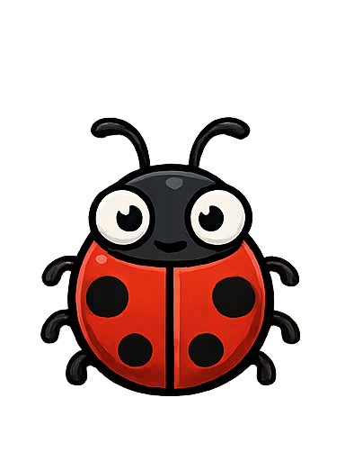
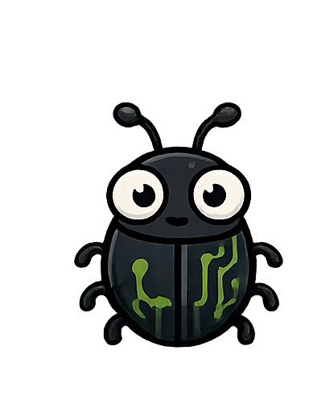
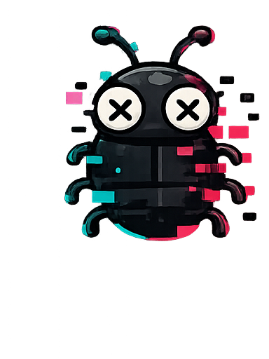
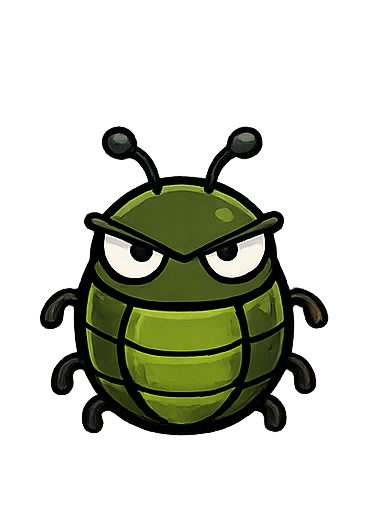
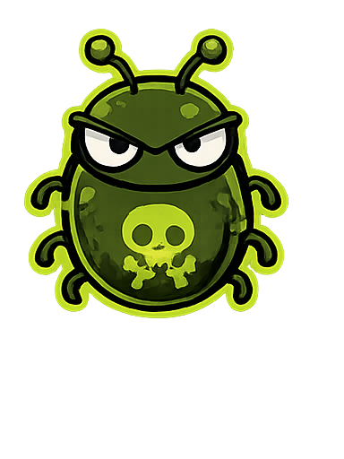
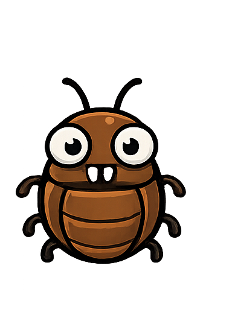
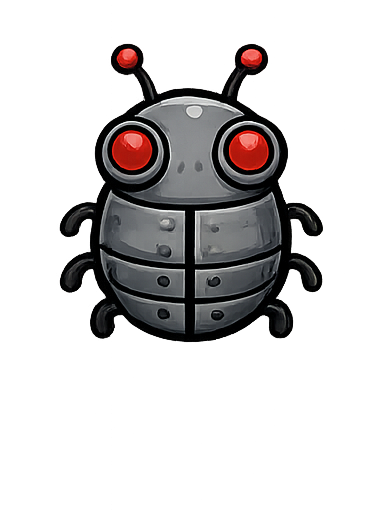

# 05 · Characters

The cast. Stickman developer is the player; bugs are the enemies; the PM is a recurring NPC in single-player.

---

## Player — Dev Stickman

### Identity
- Generic developer with **round glasses**, dark hair, holding an **open laptop** as their primary weapon
- Skin tone: light beige (`#fcd9b6`); hair: dark brown
- Always holds the laptop in some pose — laptop is *both* weapon and identity prop

### Sprite poses

| Pose | File | Usage |
|---|---|---|
| Idle | `idle.svg` | Standing, laptop in front |
| Run | `run.svg` + `run2.svg` | 2-frame alternating cycle while moving |
| Smash | `smash.svg` | Overhead slam (Q + click-bug) |
| Punch | `punch.svg` | Sideways laptop swing (W) |
| Kick | `kick.svg` | Leg extended, yellow impact lines (E) |
| Parry | `parry.svg` | Defensive crouch, laptop as shield (R + broken state) |
| Jump | `jump.svg` | Knees tucked, hair flying up (SPACE) |
| Dead | `dead.svg` | SP-only loss screen |
| PM variant | `pm.svg` | NPC counterpart, red sweater, angry shout |

All in [assets/characters/stickman/](../../../assets/characters/stickman/).

### Scaling with progression

Sprite displays at `78 × 100 px × scale[level]`. See [03_PROGRESSION.md](./03_PROGRESSION.md) for the scale table.

### Identity color

Each player gets one of 16 palette colors on join (palette cycles after 16). The color appears in:
- Colored ground ring under feet
- Aura ring (Lv5+)
- Nameplate text
- Minimap dot
- Selection ring when targeted by another player

### Future cosmetics (🔵)

- Laptop skins (cracked, neon, holographic, etc.)
- Hair styles (afro, mohawk, balding, bun)
- Accessory props (coffee mug, energy drink, mechanical keyboard floating beside)
- Title flavor (e.g. "Senior" → "Senior Architect")

---

## Enemies — Bugs

7 kinds (post 2026-05-31 late-session rebalance). Each is a server-driven entity with its own HP, speed, score, and personality. Harder bugs reward more score; some attack players and/or leave death effects.

| Sprite | Name | HP | Speed | Weight | Score | Personality |
|---|---|---|---|---|---|---|
|  | `bug-ladybug` | 1 | 35 | **7** | 5 | **Swarm-eater**: most common kind; eats code obstacles at 2× rate. Pop-of-dust death. |
|  | `bug-null` | 2 | 45 | 4 | 8 | Common cannon fodder. Standard flee. Smoke-puff death. |
|  | `bug-race` | 2 | 130 | 2 | 15 | Sprints constantly — hard to catch. Speed-line death. |
|  | `bug-beetle` | 3 | 55 | 2 | 20 | **Aggressive**: 320 px aggro, 6 HP nip / 0.9 s, 1.25× chase. Shockwave-ring death. |
|  | `bug-toxic` | 4 | 60 | 1 | 25 | Tanky. **Death spawns a 70 px green poison cloud (6 HP / 600 ms × 1.8 s)** — don't kill in chokepoints. Softened 2026-06-02 (was 10 HP/450 ms — instakilled intern in 2 s). |
|  | `bug-scarab` | 5 | 35 | 1 | 30 | Armored tank. Slow but unyielding. 14-fragment burst death. |
|  | `bug-robot` | **6** | 75 | 1 | 50 | **Boss-tier**: 420 px aggro, straight-line charge (no turn-lerp), 1.4× chase, 12 HP slam / 1.8 s. White flash + 8 electric arcs + camera shake on death. HP 7→6 on 2026-06-02 for intern accessibility. |

### Weights → spawn distribution

Total weight = 18. So:
- `bug-ladybug` ≈ **39%** (the swarm)
- `bug-null` ≈ 22%
- `bug-beetle` ≈ 11%
- `bug-race` ≈ 11%
- `bug-toxic` ≈ 6%
- `bug-scarab` ≈ 6%
- `bug-robot` ≈ 6%

Roughly **39% HP-1 bugs** (the ladybug swarm), **61% multi-hit**. Game is HARDER per kill but ladybugs flood the field, creating constant pressure especially around code obstacles.

### Player damage from bugs

Two aggressive kinds (beetle, robot) actively pursue and damage players on contact. Toxic deals damage indirectly via its death cloud. Both PvE damage sources respect defensive skills: **Shield** absorbs one hit then breaks, **Roll/Jump invuln** dodges entirely.

### Bug death + corpse

- Each bug has a **kind-specific kill effect** (ladybug dust pop, null smoke puff, race speed lines, beetle shockwave ring, scarab fragments, robot electric arcs + camera shake, toxic green cloud).
- Bugs ALSO drop a persistent **`bug-dead.png` corpse** (50×50, slight random tilt) that stays visible for **4 s solid + 1 s fade = 5 s total**, independent of how fast the server removes the bug entity.
- Hit feedback (non-fatal): server bumps `Bug.hit_seq`, client flashes the bug body red + scale punch + 2 yellow sparks. Multi-HP bugs (beetle/toxic/scarab/robot) clearly register each hit.

### Bugs eat code obstacles

Every 1500 ms the server scans each obstacle and applies damage from nearby bugs (within 80 px): 1 HP per bug, **2 HP for ladybugs**, capped 4/tick. When an obstacle hits 0 HP, **2–4 fresh bugs emerge** from the wreckage. This creates the swarm-chain-reaction dynamic: ladybugs near a code block crack it → spawns new bugs → those eat the next obstacle → swarm runaway. Players must control bug density around obstacles OR pre-break obstacles themselves.

### AI behavior

All bugs share the same behavior tree:

```
                ┌──────────────────────┐
                │                      │
       ┌────►───┤  WANDER (idle)       │
       │        │  random dir change   │
       │        │  every 1.5–3 s       │
       │        │  speed = base × 0.6  │
       │        └──────────┬───────────┘
       │                   │ player within 220 px
       │                   ▼
       │        ┌──────────────────────┐
       │  ◄─────┤  FLEE                │
       │ player │  direct opposite of  │
       │ leaves │  nearest player      │
       │  220px │  speed = base × 2.2  │
                └──────────────────────┘
```

- Heading lerps smoothly (no instant 180° turns)
- Bounces off arena walls
- Bugs age out at 26 s

### Bug death

- Visual: squash flat + alpha fade (240 ms tween)
- Audio: `AudioManager.bugKill()`
- Server removes from `state.bugs` after 400 ms (gives the death animation time)

### Hidden state (currently unused in MP)

🚫 The schema has a `hidden` field for the SP "dive on survival" mechanic. Not triggered in MP because dive made the lock-on chase feel broken.

---

## NPC — PM (Project Manager)

Single-player only. Appears in end-game dialog screens.

### Identity
- Red sweater, brown hair, **glasses**, angry expression
- Holds clipboard or yells from outside the frame
- Stands as the foil to the dev player

### Pose
- `pm.svg` — angry pointing finger, shouting open mouth, red sweater

### Behavior
- End-game dialog box: PM and DEV exchange comic-book bubbles
- Lines from [src/data/talk.js](../../../src/data/talk.js)
- Branches by win/lose category:
  - `win.short` / `win.epic` — based on time remaining
  - `lose.short` / `lose.epic` / `lose.badEnding` — based on kill ratio

🔵 **Design intent (MP):** the PM could appear as an ambient voice nagging the room over PA — "Stop slacking, Junior!" — without an actual NPC sprite. Cheap to add, big personality boost.

---

## Boss bug (🔵 designed, not built)

A "Mega Deadline Bug" finale for Mode B. Multi-phase, room-scale, with telegraphed attacks. Defers until base MP feels solid.
